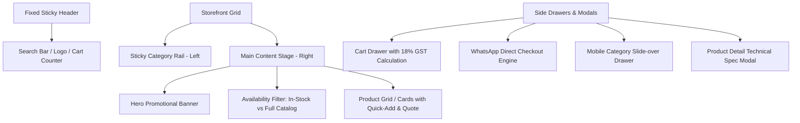
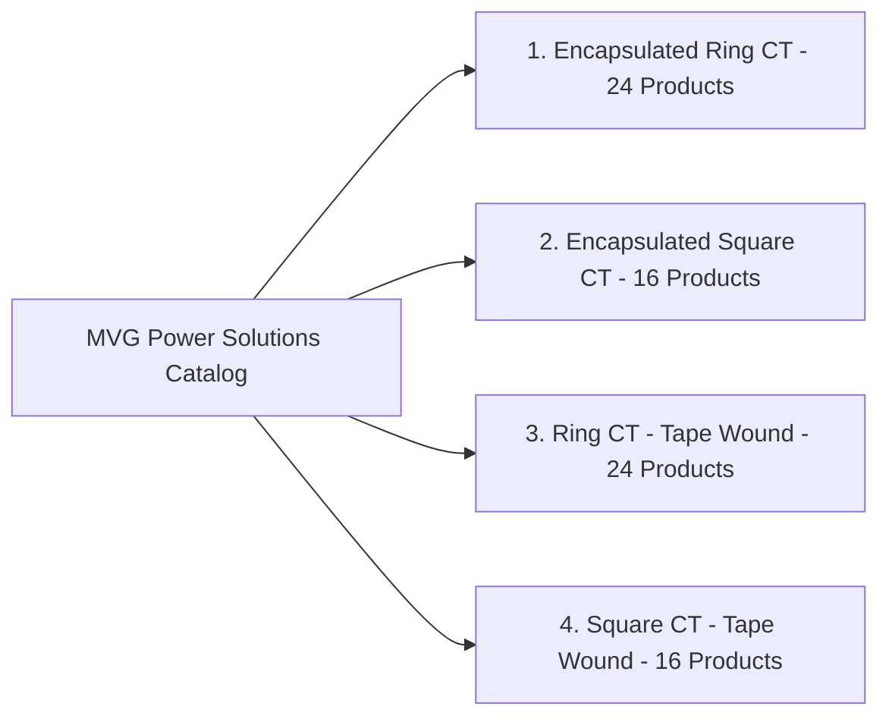

# MVG Power Solutions — Brand Guide & Website Recreation Blueprint
**Reference URL:** [https://www.mvgpowersolutions.com/](https://www.mvgpowersolutions.com/)  
**Document Version:** 1.0.0  
**Generated On:** October 2026  

---

## 1. Executive Summary & Brand Overview

**MVG Power Solutions** is an electrical engineering and manufacturing brand specializing in industrial **Current Transformers (CTs)**, **Digital Energy Meters**, and power distribution accessories across India. The brand operates with an industrial B2B / wholesale direct-supply model, connecting electrical panel builders, switchgear manufacturers, contractors, and industrial plants directly with factory-grade electrical components.

### 1.1 Brand Identity & Values
* **Brand Name:** MVG Power Solutions
* **Tagline / Slogan:** *"Power You Trust"*
* **Core Philosophy:** Precision electrical measurement, rugged industrial durability, transparent wholesale pricing, and instant WhatsApp-driven procurement.
* **Target Audience:** Electrical contractors, switchgear OEMs, control panel builders, solar system integrators, maintenance engineers, and industrial procurement managers.

### 1.2 Official Contact & Operating Details
* **Registered Address:** R-458, Ground Floor, R Block, Mangol Puri, New Delhi – 110083, India
* **Geo Coordinates:** Latitude `28.6914744`, Longitude `77.0851993`
* **Direct Phone & WhatsApp:** `+91 78360 04040` (`917836004040`)
* **Email:** `info@mvgpowersolutions.com` / `mvgpowersolutions40@gmail.com`
* **Operating Currency:** Indian Rupee (`INR` / `₹`)
* **GST Rate:** Standard Electrical Hardware GST @ `18%`

---

## 2. Brand Visual Design System

The MVG brand aesthetic combines industrial electrical authority with clean, modern e-commerce utility.

### 2.1 Color Palette

| Token Name | Hex Code | RGB | Usage & Purpose |
| :--- | :--- | :--- | :--- |
| **Brand Primary (Safety Orange)** | `#F74D00` | `rgb(247, 77, 0)` | Primary CTA buttons, active state accents, category pill highlights, key badges. Reflects energy, warning/safety standards, and high visibility. |
| **Brand Dark (Industrial Navy)** | `#052C6E` | `rgb(5, 44, 110)` | Button hover states, authoritative corporate elements, headers, logo accents. Represents electrical engineering stability and trust. |
| **Brand Light (Warm Peach)** | `#FEEAE0` | `rgb(254, 234, 224)` | Soft button backgrounds, badge backdrops, subtle highlight badges. |
| **Cart Accent (Crimson Red)** | `#B60037` | `rgb(182, 0, 55)` | Shopping cart drawer header bar and high-priority order badges. |
| **Stock Active (Signal Green)** | `#09B982` / `#13B983` | `rgb(9, 185, 130)` | "In Stock Only" indicator pill, "Ready to Ship" badge, live inventory status. |
| **Slate Dark (Text Primary)** | `#0F172A` / `#172033` | `rgb(15, 23, 42)` | Primary headings, product titles, high-contrast price tags. |
| **Slate Muted (Secondary)** | `#64748B` / `#697990` | `rgb(100, 116, 139)` | Subtitles, technical specifications, inactive icons, input placeholders. |
| **Background Neutral** | `#F7F9FC` | `rgb(247, 249, 252)` | Main storefront background canvas. Clean industrial tone. |
| **Card Surface** | `#FFFFFF` | `rgb(255, 255, 255)` | Product card background, category rail backdrop, modal sheets. |
| **Border Tone** | `#DFE6EF` / `#E5EAF1` | `rgb(223, 230, 239)` | Subtle card dividers, input borders, structural separators. |

### 2.2 Typography Hierarchy

* **Primary Font Family:** `"Nunito Sans", Inter, -apple-system, BlinkMacSystemFont, "Segoe UI", sans-serif`
* **Hierarchy Specifications:**
  * **Brand / Section Titles (`H1` / `H2`):** `24px` – `30px`, Weight: `900` / `800`, Line-height: `1.2`
  * **Product Card Titles:** `14px` – `15px`, Weight: `900`, Text-transform: `Capitalize`, Line-height: `1.28`
  * **Price Displays:** `15px` – `18px`, Weight: `700` (Bold), Color: `#0F172A`
  * **Category Navigation Links:** `13px`, Weight: `700`, Color: `#0F172A` (Hover: `#FFFFFF` with `#F74D00` pill background)
  * **Specification Key-Value Pairs:** `12px` – `13px`, Regular (`400`) & Medium (`600`)
  * **Pills & Badges:** `9px` – `11px`, Weight: `900` (Extra Bold), Uppercase, Letter-spacing: `0.5px`

### 2.3 Brand Assets & Media URLs
* **Primary Logo:** `https://www.mvgpowersolutions.com/storage/2026/08/Logo-11.png`
* **Favicon / App Icon:** `https://www.mvgpowersolutions.com/storage/2026/08/cropped-New-Project-192x192.jpg`
* **Hero Banner Image:** `https://www.mvgpowersolutions.com/storage/2026/08/banner.jpg`
* **Iconography Style:** Clean, minimalist stroke SVGs (Search lens, Shopping bag/cart, Filter funnel, WhatsApp chat icon, Chevron arrows).

---

## 3. Website Architectural Blueprint

The website features a high-density, lightning-fast B2B catalog layout optimized for rapid searching, filtering, and direct WhatsApp procurement.



### 3.1 Global Header Component
* **Desktop Dimensions:** Height `72px`, background `#FFFFFF`, bottom border `1px solid #E5EAF1`.
* **Mobile Dimensions:** Height `116px` (2 rows: Row 1 = Menu + Logo + Cart; Row 2 = Search input).
* **Key Header Elements:**
  1. **Menu Toggle:** Mobile drawer trigger button with hamburger icon.
  2. **Brand Logo Link:** Responsive logo (`height: 44px`) linking to `/`.
  3. **Universal Search Input:** Live fuzzy search across product titles, current ratings (e.g. `2500A`, `100/5A`), SKU codes, and busbar dimensions.
  4. **Quote / Cart Trigger Pill:** Soft peach background (`#FEEAE0`), orange cart icon (`#F74D00`), text `"CART"`, and dynamic badge counter showing total items selected.

### 3.2 Category Navigation Rail (Left Sidebar)
* **Desktop Behavior:** Sticky side rail (`width: 220px–240px`), height `calc(100vh - 72px)`.
* **Category Filter Input:** Live search to filter categories instantly.
* **Category List Items:**
  * Clean card items with category icon/thumbnail, title, product count badge, and right-arrow chevron.
  * Active/Hover state: Background fills with Brand Safety Orange (`#F74D00`), text turns white `#FFFFFF`.

### 3.3 Main Content & Product Showcase
* **Banner Slider:** Hero graphics highlighting current transformer capabilities, fast dispatch across India, and quality certifications.
* **Availability Toggle:**
  * Pill 1: `In Stock Only (READY TO SHIP)` with active emerald green dot.
  * Pill 2: `All Products (FULL CATALOG)`.
* **Product Card Anatomy:**
  * **Card Container:** White `#FFFFFF`, rounded corners `18px`, border `1px solid #DFE6EF`, subtle elevation shadow.
  * **Media Area:** High-resolution product photograph (`170px × 170px` on desktop) on soft slate neutral background (`#FAFBFD`).
  * **Category Chip:** Small pill tag (`font-size: 9px`, uppercase).
  * **Product Title:** Bold industrial nomenclature (e.g., *"2500/5A Ring Current Transformer 115mm CT | Class 1.0 Metering CT"*).
  * **Pricing & Units:** Transparent wholesale price in ₹ (Excl. GST).
  * **Action Controls:**
    * Quantity Selector (`-` / Input / `+`) with brand orange buttons.
    * `"Add to Cart"` / `"Quick Quote"` button (`#F74D00`, rounded `28px`).

### 3.4 WhatsApp Cart & Order Engine (Slide-Over Drawer)
* **Drawer Width:** `45vw` desktop, `72vw` tablet, `100vw` mobile.
* **Cart Header:** Burgundy crimson `#B60037` with white title `"Cart Items"`.
* **Summary Bar:** Total items selected count with quick `"🗑 Clear"` button.
* **Dynamic GST Calculation Engine:**
  $$\text{Items Subtotal} = \sum (\text{Unit Price} \times \text{Quantity})$$
  $$\text{GST Amount (18\%)} = \text{Items Subtotal} \times 0.18$$
  $$\text{Grand Total (Incl. GST)} = \text{Items Subtotal} + \text{GST Amount}$$
* **Direct WhatsApp Checkout:**
  * One-click checkout button creating a pre-formatted WhatsApp payload:
  ```text
  Hello MVG Power Solutions,
  I would like to place an order / get an official quotation:

  • 2500/5A Ring Current Transformer 115mm CT (Qty: 2) - ₹560.00
  • 1000/5A Encapsulated Square CT 80x10mm (Qty: 4) - ₹920.00

  Subtotal (Excl. GST): ₹1,480.00
  GST (18%): ₹266.40
  Grand Total: ₹1,746.40

  Please confirm availability and dispatch timeline.
  ```
* **Bulk Order Inquiry Option:** Secondary action button for custom bulk manufacturing requirements.

---

## 4. Product Taxonomy & Technical Catalog

The initial catalog comprises **40 core industrial current transformers** organized into 4 defined categories:



### 4.1 Categories Matrix

| Category ID | Category Name | Slug | Product Count | Core Application |
| :---: | :--- | :--- | :---: | :--- |
| **58** | **Encapsulated Ring CT** | `encapsulated-ring-ct` | 24 | Resin-molded circular CTs with high mechanical strength & moisture resistance for cables and circular conductors. |
| **43** | **Encapsulated Square CT**| `encapsulated-square-ct` | 16 | Resin-encapsulated square CTs designed for standard rectangular busbars in power control panels. |
| **60** | **Ring CT** | `ring-ct` | 24 | High-efficiency tape-wound circular current transformers for standard metering and monitoring. |
| **59** | **Square CT** | `square-ct` | 16 | Classic tape-wound rectangular aperture current transformers for switchboard busbars. |

### 4.2 Standard Technical Attributes
* **Primary Current Ranges:** `30A`, `50A`, `75A`, `100A`, `150A`, `200A`, `250A`, `300A`, `400A`, `500A`, `600A`, `800A`, `1000A`, `1200A`, `1250A`, `1500A`, `1600A`, `2000A`, `2500A`, `3000A`, `3200A`, `4000A`.
* **Secondary Current Output:** Standard `5A` (or `1A` on custom order).
* **Accuracy Classes:**
  * **Class 1.0:** General industrial energy metering, ammeters, and current monitoring.
  * **Class 0.5 / 0.5S:** High-precision commercial billing and tariff metering.
  * **Class 5P10 / 10P10:** Protection class CTs for protective relays.
* **Rated Burden (VA):** `2.5 VA`, `5 VA`, `7.5 VA`, `10 VA`, `15 VA`.
* **Inner Diameters (ID):** `30 mm`, `45 mm`, `65 mm`, `85 mm`, `100 mm`, `115 mm`, `140 mm`.
* **Busbar Apertures:** `30×10 mm`, `40×10 mm`, `60×10 mm`, `80×10 mm`, `100×10 mm`, `120×10 mm`.

---

## 5. Step-by-Step Recreation Roadmap

This project recreation is planned in sequential, verifiable phases:

### Phase 1: Brand System & Data Assets ✅ *(Current Step)*
- [x] Complete brand analysis and specification documentation (`BRAND_GUIDELINES.md`).
- [x] Extract complete JSON data schemas (`data/categories.json` and `data/products.json`).
- [x] Archive all brand logos, banner assets, and font configurations.

### Phase 2: Modern Frontend Architecture & Scaffolding
- [ ] Determine optimal web stack (e.g. Next.js / Astro / Vite React / Tailwind CSS).
- [ ] Setup modern styling system featuring exact MVG brand tokens (`--brand`, `--brand-dk`, `--brand-lt`, `--black`, etc.).
- [ ] Configure asset optimization for high-DPI product photos and SVGs.

### Phase 3: Core Catalog & Layout Engineering
- [ ] Implement responsive Fixed Header with search and cart badge.
- [ ] Build Left Category Rail with instant real-time filtering.
- [ ] Build Product Grid with high-density responsive layout (desktop 2-column cards, tablet & mobile stacked).
- [ ] Implement Availability Toggle (`In Stock` vs `All Products`).

### Phase 4: Shopping Cart & Direct WhatsApp Engine
- [ ] Build slide-over cart drawer with smooth micro-animations.
- [ ] Implement reactive quantity controls with instant state persistence (localStorage).
- [ ] Implement exact 18% GST calculation (Subtotal, GST, Grand Total).
- [ ] Build automated WhatsApp URI generator linking directly to `+917836004040`.

### Phase 5: Technical Detail Modals & SEO Optimization
- [ ] Build detailed product view modal with dimension schematics and technical tables.
- [ ] Embed Schema.org JSON-LD structured data (Product, Organization, Place, AggregateRating).
- [ ] Audit performance, accessibility (WCAG), and mobile responsiveness.

---

## 6. Code & Data References
* **Categories Data:** [`data/categories.json`](file:///Users/vishalgupta/Desktop/Antigravity/MVG%20Website/data/categories.json)
* **Products Data:** [`data/products.json`](file:///Users/vishalgupta/Desktop/Antigravity/MVG%20Website/data/products.json)
* **Live Target URL:** [https://www.mvgpowersolutions.com/](https://www.mvgpowersolutions.com/)
